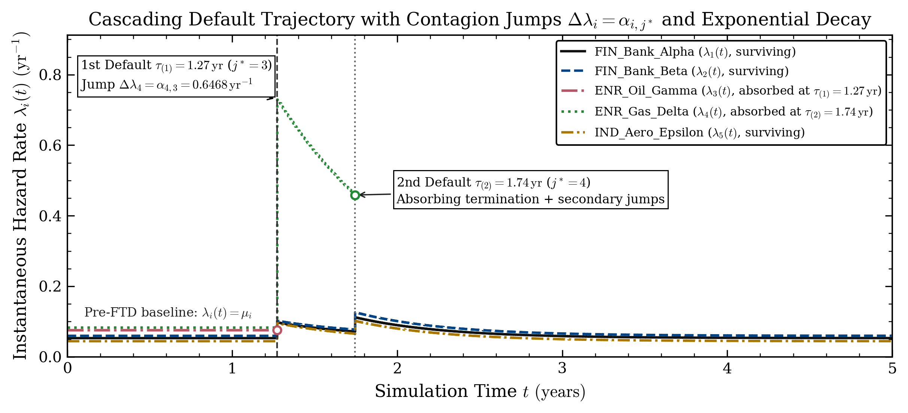
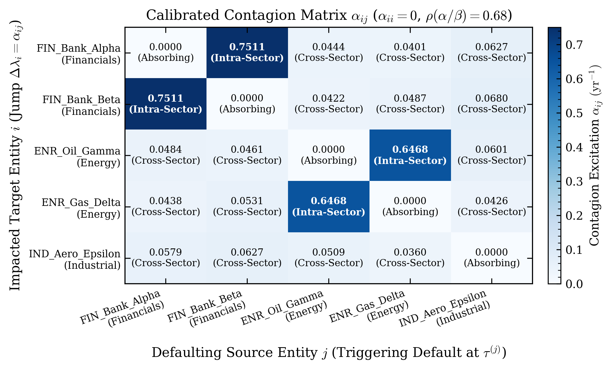
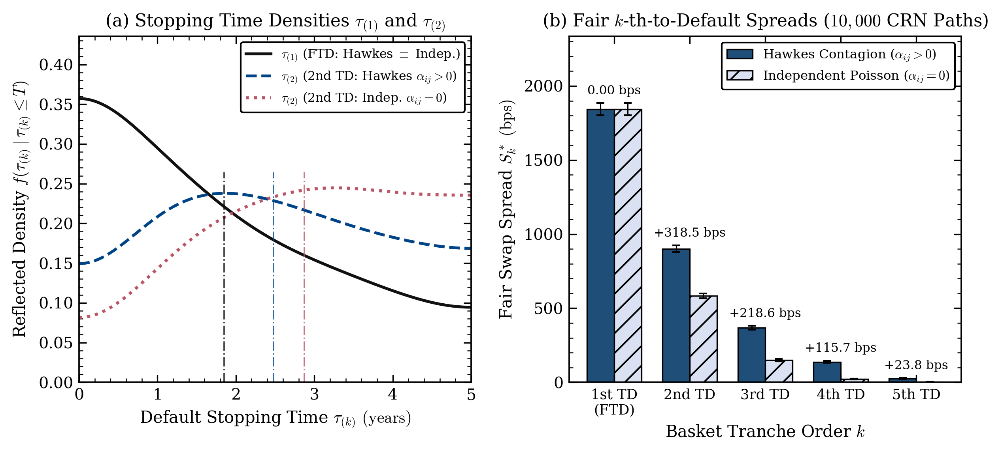

# Modeling Infectious Default Risk in Basket Credit Derivatives: From First-to-Default (FTD) Swaps to $k$-th-to-Default Tranches

**Pythoneers - The Quantitative Finance Society of Católica Lisbon: Technical Project & Learning Note**

[](https://www.python.org/)
[](docs/project_note.pdf)
[](tests/test_hawkes_credit.py)

> **Full Project & Learning Note (PDF)**: [**`docs/project_note.pdf`**](docs/project_note.pdf) *(LaTeX source: [`docs/project_note.tex`](docs/project_note.tex))*

---

## 1. Project Scope & Model Mechanics

Standard textbook models for multi-name credit baskets, such as the one-factor Gaussian copula, link corporate default times through a static latent correlation parameter. While convenient for quick quoting, static copulas lack a dynamic time-series mechanism for **default clustering**: when a major financial institution or energy producer defaults, counterparty losses and liquidity squeezes immediately push up the default hazard rates of surviving firms in the same sector.

In this project (`hawkes_credit.py`), we build an end-to-end continuous-time **multivariate mutually exciting Hawkes point process** for a 5-name corporate credit basket over a $T = 5.0\text{ year}$ horizon:

$$\lambda_i(t) = \mu_i + \sum_{j=1}^{N} \int_{(0, t]} \alpha_{ij} \, e^{-\beta_{ij}(t - s)} \, \mathrm{d}N_j(s) = \mu_i + \sum_{m : \tau_{(m)} \le t} \alpha_{i, j_{(m)}} \, e^{-\beta_{i, j_{(m)}}(t - \tau_{(m)})}$$

where $\mu_i > 0$ denotes the baseline idiosyncratic hazard rate ($\text{yr}^{-1}$). Upon default of entity $j$ at $\tau_{(m)}$, entity $i$ experiences an instantaneous upward intensity jump $\alpha_{ij} \ge 0$ that subsequently mean-reverts at the exponential decay rate $\beta_{ij} > 0$.

### Absorbing Default States & Ogata's Modified Thinning Algorithm

Unlike high-frequency trading applications where Hawkes events recur indefinitely, corporate default is an **absorbing state** (`absorbing_defaults=True` across all dataclasses, calibration functions, and simulators):
1. **Active Survival Masking**: Each entity $i$ can default at most once per trajectory. Once entity $j^*$ defaults at $\tau_{(m)}$, its survival indicator $Y_{j^*}(t) = \mathbb{1}_{\{\tau_{j^*} > t\}}$ drops to zero and the active portfolio intensity becomes $\Lambda(t) = \sum_{i=1}^N Y_i(t^-) \lambda_i(t)$.
2. **Zero Diagonal Self-Excitation ($\alpha_{ii} = 0$)**: In `map_correlation_to_contagion_matrix`, we force the diagonal of $\boldsymbol{\alpha}$ to `0.0` *before* scaling to the target spectral radius $\rho(\boldsymbol{\alpha} \oslash \boldsymbol{\beta}) = 0.68 < 1$, ensuring defaulted obligors cannot self-excite. Because $\lambda_i(t)$ decays monotonically between default arrivals, `MultivariateHawkesCreditSimulator` simulates exact default timestamps without time-stepping discretization bias using Ogata's modified thinning algorithm.



---

## 2. Core Modeling Takeaway: Why FTD Swaps Do Not Price Contagion

One of the most valuable lessons from building this pricer emerged when we compared our calibrated Hawkes model ($\alpha_{ij} > 0$) against an independent Poisson baseline ($\alpha_{ij} = 0$) on a **First-to-Default (FTD)** swap ($k=1$): both models produced the exact same fair FTD spread (**$1843.11\text{ bps}$**).

An FTD contract terminates at the first default stopping time $\tau_{(1)} = \min_{1 \le i \le N} \tau_i$. For every timestamp $t < \tau_{(1)}$, no default has occurred in the basket, so the counting processes satisfy $N_j(t^-) = 0$ for all $j \in \{1, \dots, N\}$. Consequently, the stochastic contagion integral in Equation (1) vanishes on $[0, \tau_{(1)})$, which reduces each entity's pre-FTD intensity to its constant baseline rate $\lambda_i(t) = \mu_i$ and yields the constant aggregate basket intensity:

$$\Lambda(t) = \sum_{i=1}^{N} \mu_i \equiv \Lambda_0 \qquad \forall \, t < \tau_{(1)}$$

Because $\Lambda(t) = \Lambda_0$ does not depend on $\alpha_{ij}$ or $\beta_{ij}$ prior to $\tau_{(1)}$, the first default time follows $\tau_{(1)} \sim \mathrm{Exponential}\!\left(\sum_{i=1}^N \mu_i\right)$ under both models. Self-exciting contagion only turns on **at and after $\tau_{(1)}$**. To see Hawkes contagion reprice basket credit risk, we must extend the pricer to **$k$-th-to-Default tranches ($k = 2, 3, 4, 5$)**, whose cash flows depend on how quickly subsequent defaults cascade after the first shock.

---

## 3. Calibration Walkthrough & Contagion Matrix

We construct a synthetic 5-name corporate basket distributed across Financials, Energy, plus a single Industrial obligor, evaluated under a constant continuous risk-free rate $r = 4.0\%$ over a $T = 5.0$ year horizon:
1. **Single-Name CDS Bootstrap (`extract_baseline_hazard_rates_from_cds`)**: Solves the exact quarterly par CDS equation with mid-period accrued premium on default via vectorized fixed-point iteration, recovering the input par spreads `[320, 360, 420, 460, 290]` bps to within $10^{-10}\text{ bps}$.
2. **Sector Contagion Mapping (`map_correlation_to_contagion_matrix`)**: Off-diagonal entries ($i \ne j$) scale pairwise asset correlation $\rho_{ij}^{1.25}$ by source loss severity $\text{LGD}_j / \overline{\text{LGD}}$, weighted by sector co-membership multipliers ($w_{\text{intra}} = 2.40$ for same-sector pairs versus $w_{\text{cross}} = 0.65$ for cross-sector pairs). Intra-sector contagion decays more slowly ($\beta_{\text{intra}} = 1.15\text{ yr}^{-1}$) than cross-sector spillovers ($\beta_{\text{cross}} = 1.85\text{ yr}^{-1}$) with spectral radius $\rho(\boldsymbol{\alpha} \oslash \boldsymbol{\beta}) = 0.68$.

| Entity ID | Reference Entity | Sector | 5Y CDS Spread (bps) | LGD ($1 - R_i$) | Implied Recovery $R_i$ | Bootstrapped $\mu_i$ ($\text{yr}^{-1}$) |
| :---: | :--- | :--- | :---: | :---: | :---: | :---: |
| $i=1$ | `FIN_Bank_Alpha` | Financials | $320.0$ | $0.60$ | $40\%$ | $0.053067$ |
| $i=2$ | `FIN_Bank_Beta` | Financials | $360.0$ | $0.60$ | $40\%$ | $0.059701$ |
| $i=3$ | `ENR_Oil_Gamma` | Energy | $420.0$ | $0.55$ | $45\%$ | $0.075984$ |
| $i=4$ | `ENR_Gas_Delta` | Energy | $460.0$ | $0.55$ | $45\%$ | $0.083220$ |
| $i=5$ | `IND_Aero_Epsilon` | Industrial | $290.0$ | $0.65$ | $35\%$ | $0.044393$ |
| **Total** | **Pre-FTD Basket Sum ($\Lambda_0 = \sum \mu_i$)** | N/A | N/A | N/A | N/A | **$0.316365$** |



---

## 4. $k$-th-to-Default Monte Carlo Results & Implementation Lessons

Using `np.random.SeedSequence(42).spawn(10_000)` to synchronize pathwise **Common Random Numbers (CRN)** across $10,000$ trajectories, `MonteCarloFTDPricer` prices all five $k$-th-to-Default tranches simultaneously under both the Hawkes Contagion model ($\alpha_{ij} > 0$) and the Independent Poisson baseline ($\alpha_{ij} = 0$):

| Tranche Order $k$ | 5Y Default Prob. (Hawkes) | 5Y Default Prob. (Indep.) | Mean $\tau_{(k)}$ Hawkes (yr) | Mean $\tau_{(k)}$ Indep. (yr) | Hawkes Spread $S_k^*$ (bps) | Hawkes SE (bps) | Indep. Spread $S_k^{*,0}$ (bps) | Indep. SE (bps) | Contagion Premium $\Delta S_k^*$ (bps) |
| :---: | :---: | :---: | :---: | :---: | :---: | :---: | :---: | :---: | :---: |
| **$k = 1$ (1st TD / FTD)** | $79.23\%$ | $79.23\%$ | $1.8484$ | $1.8484$ | **$1843.11$** | $\pm 20.95$ | **$1843.11$** | $\pm 20.95$ | **$0.00$** |
| **$k = 2$ (2nd TD)** | $56.42\%$ | $42.02\%$ | $2.4793$ | $2.8751$ | **$901.77$** | $\pm 11.37$ | **$583.31$** | $\pm 8.44$ | **$+318.47$** |
| **$k = 3$ (3rd TD)** | $28.54\%$ | $12.76\%$ | $3.0041$ | $3.4708$ | **$368.22$** | $\pm 6.61$ | **$149.62$** | $\pm 4.08$ | **$+218.61$** |
| **$k = 4$ (4th TD)** | $11.76\%$ | $1.98\%$ | $3.3334$ | $3.8863$ | **$137.82$** | $\pm 3.94$ | **$22.12$** | $\pm 1.57$ | **$+115.70$** |
| **$k = 5$ (5th TD)** | $2.24\%$ | $0.18\%$ | $3.6036$ | $4.0093$ | **$25.79$** | $\pm 1.72$ | **$2.01$** | $\pm 0.47$ | **$+23.78$** |



### Practical Coding Lessons
1. **Pathwise Common Random Numbers (`SeedSequence.spawn`)**: Assigning each path $p \in \{1, \dots, 10,000\}$ its own spawned RNG stream guarantees that path $p$ draws the exact same first inter-arrival time $\tau_{(1)}$ and defaulting entity $j_{(1)}$ in both models, verifying $S_1^{*,\text{Hawkes}} - S_1^{*,\text{Indep}} = 0.00\text{ bps}$ to machine precision ($< 10^{-12}$) while sharply reducing Monte Carlo variance on the senior tranche differences $\Delta S_k^*$.
2. **Fixing KDE Boundary Bias at $t = 0$ (`compute_reflected_kde`)**: Because $\tau_{(1)} \sim \mathrm{Exponential}(\Lambda_0)$ peaks at $t = 0$, a standard Gaussian KDE on $[0, T]$ spills probability mass into $t < 0$ and creates a false drop near $t = 0$. Fitting `scipy.stats.gaussian_kde` on the double-reflected array `np.concatenate([taus, -taus, 2.0 * horizon - taus])` and multiplying the evaluated density on $[0, T]$ by `3.0` eliminates boundary bias at both $t = 0$ and $t = T$.

---

## 5. Repository Structure & Quickstart

```text
credit_exotics_ftd_project/
├── hawkes_credit.py                  # Core Hawkes simulator, CDS calibrator, CRN k-th-to-Default pricer & figure engine
├── docs/
│   ├── project_note.tex              # LaTeX source for the Pythoneers Technical Project & Learning Note
│   └── project_note.pdf              # Compiled PDF learning note
├── figures/                          
│   ├── fig1_cascading_hazard_path.png
│   ├── fig2_contagion_matrix.png
│   └── fig3_kth_default_tranches.png
├── tests/
│   └── test_hawkes_credit.py         # Automated pytest verification suite
├── requirements.txt                  # Scientific Python dependencies
├── .gitignore                        # Python, virtual environment, and LaTeX build exclusions
└── README.md                         # Project overview and results
```

```bash
# 1. Install dependencies
pip install -r requirements.txt

# 2. Run calibration, 10,000-path CRN k-th-to-Default pricing, and generate 300 DPI PNG figures
python3 hawkes_credit.py

# 3. Run the automated pytest verification suite
pytest -v
```
